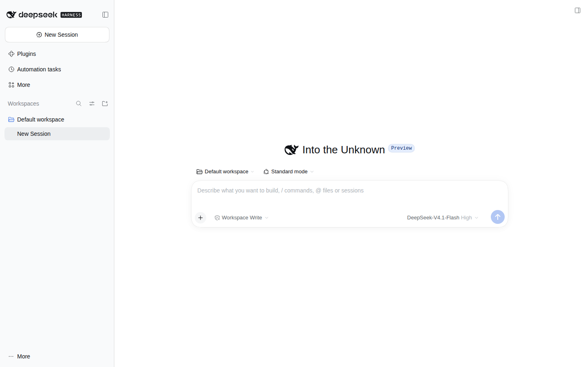

<p align="center">
  
</p>

<p align="center">
  <a href="LICENSE"></a>
  <a href="https://github.com/butterpurse-dot/deepseek-harness-linux/releases"></a>
  <a href="https://github.com/butterpurse-dot/deepseek-harness-linux/actions/workflows/sync-upstream.yml"></a>
  <a href="#平台支持"></a>
  <a href="https://butterpurse-dot.github.io/deepseek-harness-linux/"></a>
</p>

<p align="center">
  
</p>

# DeepSeek Harness · Linux 桌面版

[English](README.md) | 中文

为官方 [DeepSeek Harness](https://github.com/deepseek-ai/deepseek-harness) 桌面端提供社区 Linux 打包。这是一个下游构建，不是 DeepSeek 官方项目。

上游桌面端只发布 macOS 和 Windows 版本。本仓库增加 Linux 目标，发布 **AppImage**、**`.deb`**、**`.rpm`** 和 **`.tar.gz`**，覆盖 x64 与 arm64；AppImage 通过 `electron-updater` 和 GitHub Releases 自动更新。

## 为什么选这个仓库

- 除了 AppImage、deb、tar.gz，还提供 **RPM**，方便 Fedora/RHEL 用户。
- **x64 与 arm64** 双架构，arm64 单独发布。
- **AppImage 自动更新**，以及带校验和验证的 `dsh-update` 命令行更新器。
- **一条命令安装**，每个版本都发布 `SHA256SUMS.txt`。
- **每小时同步上游**，自动 rebase、测试并发布。

## 安装

一条命令（安装到 `~/.local`）：

```sh
curl -fsSL https://github.com/butterpurse-dot/deepseek-harness-linux/releases/latest/download/install-linux.sh | bash
```

然后运行 `deepseek-harness`，或从应用菜单打开 **DeepSeek Harness**。

也可以从 [Releases](https://github.com/butterpurse-dot/deepseek-harness-linux/releases) 手动安装：

| 格式 | 安装 |
|---|---|
| AppImage | `chmod +x deepseek-harness-*.AppImage && ./deepseek-harness-*.AppImage` |
| Debian / Ubuntu | `sudo apt install ./deepseek-harness-*.deb` |
| Fedora / RHEL | `sudo dnf install ./deepseek-harness-*.rpm` |
| 便携版 | `tar -xzf deepseek-harness-*.tar.gz && ./deepseek-harness-*/deepseek-harness` |

每个版本都附带 `SHA256SUMS.txt`，可用 `sha256sum -c SHA256SUMS.txt` 校验。

部分发行版运行 AppImage 需要 FUSE 2：

```sh
sudo apt install libfuse2        # Debian / Ubuntu
sudo dnf install fuse2           # Fedora / RHEL
```

## 更新

应用启动时以及之后每六小时检查 GitHub Releases。发现新版本后，侧边栏会出现提示，设置页会弹出更新对话框：先询问是否下载，下载完成后点击 **Install and Restart** 安装并重启。

已安装的 `dsh-update` 命令提供同样的下载、校验和安装流程：

```sh
dsh-update --check   # report whether a newer release exists
dsh-update           # download, verify SHA256SUMS and replace the installed AppImage
dsh-update --force   # reinstall the current release
```

`dsh-update` 会把已安装的 AppImage 与发布页的校验和比较，因此损坏或被手动修改的副本会被重新安装。`.deb` 和 `.tar.gz` 用户需要下载并安装新版本。

arm64 版本单独发布为 `v<version>-arm64`，并使用复制到 x64 release 的 `latest-linux-arm64.yml` feed，因此 arm64 AppImage 也会自动更新。单独的 arm64 release 仍可用于手动下载。

## 包含内容

- 官方 Electron 桌面应用（`apps/desktop`），除 Linux 目标和桌面图标接线外不做修改。
- 内置 Node、pnpm 和 Python 运行时，无需系统安装 Node。
- 官方 agent、插件、工作区和 `dsh://` 协议行为。

## 平台支持

| 平台 | 产物 | 自动更新 |
|---|---|---|
| Linux x64 | AppImage、`.deb`、`.rpm`、`.tar.gz` | 仅 AppImage |
| Linux arm64 | AppImage、`.deb`、`.rpm`、`.tar.gz`（单独发布） | 仅 AppImage |

**系统要求：** x64 或 arm64 Linux，glibc 2.28+，约 450 MB 磁盘空间。AppImage 需要 FUSE 2（Debian/Ubuntu 为 `libfuse2`，Fedora 为 `fuse2`）；没有 FUSE 时可用 `--appimage-extract-and-run` 运行。

**已知限制**

- 构建未签名，桌面环境首次启动时可能提示风险。每个版本都附带 `SHA256SUMS.txt`，运行前请校验。
- Office 文档转换使用 WASM 引擎，因为上游没有发布 Linux 原生 LibreOfficeKit 包。
- 更新器只向前更新。如需回退到旧版本，请下载对应 tag 并重新安装。

## 从源码构建

要求：Linux x64、Node 24.9+、pnpm 11、git。

```sh
git clone https://github.com/butterpurse-dot/deepseek-harness-linux
cd deepseek-harness-linux
corepack enable
corepack prepare pnpm@11.28.5 --activate
pnpm install --frozen-lockfile
pnpm run build
pnpm --filter @deepseek-ai/dsh-desktop run package:linux:x64 -- --unsigned
```

产物位于 `apps/desktop/.desktop-build/targets/linux-x64/unsigned-artifacts/`。

## 与上游同步

本仓库自动跟踪 `deepseek-ai/deepseek-harness`。定时工作流会获取最新的上游发布 tag，把 Linux 提交 rebase 到该 tag 上，运行 `pnpm run typecheck`，推送 `master`，并启动发布构建。如果 rebase 或类型检查失败，会打开 `upstream-sync` issue，并保留上一个可用版本。

Linux 相关改动仅限于桌面目标解析、打包目标表、electron-builder Linux 配置，以及桌面图标/桌面名称接线。其余代码均来自上游。

## 维护

这是一个尽力而为的社区构建，没有 SLA，也没有常驻维护者。定时工作流每小时检查上游，把 Linux 改动 rebase 到新版本并自动发布。Issue 和 Pull Request 由社区在有时间时处理。

如果同步工作流被阻塞，会打开 `upstream-sync` issue 并附上失败的运行链接；任何人都可以修复。

## 参与贡献

欢迎提交打包修复、安装器改进和发行版兼容性报告。详见 [CONTRIBUTING.zh.md](CONTRIBUTING.zh.md)。

如果它帮你省去了一次构建，点个 star 能帮助更多 Linux 用户找到它。

## 许可证

MIT，与上游一致。DeepSeek Harness 是 DeepSeek AI 的项目；本仓库是独立的社区构建。
